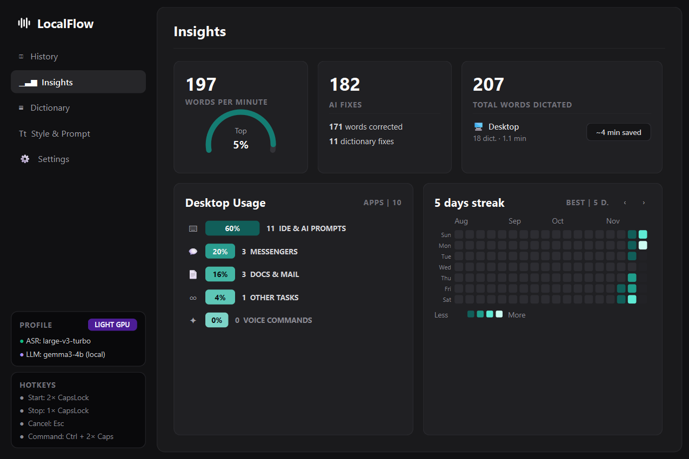
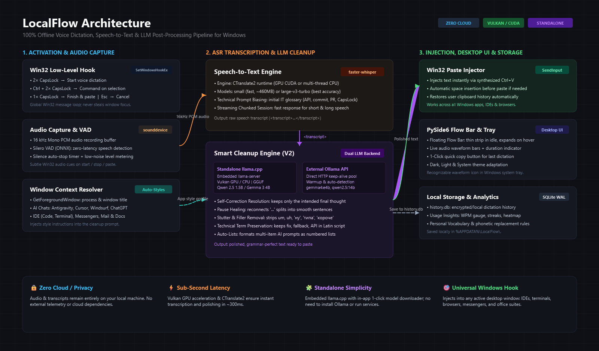

# LocalFlow

<p align="center">
  <strong>Local, privacy-first, open-source Wispr Flow alternative for Windows.</strong><br>
  Offline voice dictation & smart LLM text cleanup. 100% private, zero cloud dependencies.
</p>

<p align="center">
  <a href="https://github.com/AzurySound/localflow/releases/latest">
    
  </a>
</p>

<p align="center">
  
</p>

<p align="center">
  
  
  
  
</p>

---

## How It Works

| Hotkey | Action |
|---|---|
| `2× CapsLock` | **Start dictating** anywhere in Windows. |
| `CapsLock` | **Finish & Paste**: transcribes, cleans up speech, and pastes into the active field. |
| `Ctrl + 2× CapsLock` | **Command on Selection**: highlight text and tell LocalFlow what to do (*"summarize"*, *"translate"*, *"make a list"*). |
| `Esc` | **Cancel** without pasting. |

<p align="center">
  
</p>

---

## Key Features

- **100% Local & Private**: Audio and text never leave your computer. No accounts, API keys, or subscriptions.
- **Smart Speech Cleanup**: Removes filler words (*"um"*, *"uh"*, *"you know"*, *"ну то есть"*), fixes stutters, glues awkward pause breaks, and resolves mid-sentence corrections (*"let's add a button, actually let's finish for today"* &rarr; keeps only the final thought).
- **IT & Technical Terms**: Preserves English programming terms, CLI flags, camelCase, and snake_case in Latin script without weird transliteration.
- **App-Aware Styles**: Automatically formats text to match what you are doing:
  - 🤖 **AI Chats & IDEs** (Antigravity, Cursor, ChatGPT): crisp prompts with automatic numbered lists for 3+ items.
  - 💬 **Messengers** (Telegram, Slack, Discord): natural conversational tone.
  - 📄 **Docs & Email** (Word, Notion, Outlook): clean paragraphs and bullet points.
  - ⌨ **Raw Mode**: direct transcript without LLM edits.
- **Standalone Engine**: Includes an embedded `llama.cpp` runtime with Vulkan GPU acceleration & 1-click model downloads. External **Ollama** is also supported.
- **Bilingual & Themed**: English and Russian UI with Dark, Light, and System themes.

---

## Screenshots

<p align="center">
  
</p>

<p align="center">
  
</p>

---

## Quick Install

1. Download **[LocalFlow-Setup-0.2.1.exe](https://github.com/AzurySound/localflow/releases/latest)** *(or the zero-install `LocalFlow-0.2.1-portable.zip`)*.
2. Run the installer (installs per-user, no admin rights required).
3. On first launch, download the recommended lightweight models in 1 click:
   - **Speech Recognition**: Whisper `small` (~460 MB) or `large-v3-turbo` (~1.6 GB).
   - **Smart Cleanup**: Embedded `Qwen 2.5 1.5B` (~1.0 GB) or `Gemma 3 4B` (~2.5 GB).

*(Optional: switch to Ollama in Settings if you already run models locally).*

---

## Architecture

<p align="center">
  
</p>

---

<details>
<summary><strong>For Developers: Building & Running from Source</strong></summary>

### Prerequisites
- Windows 10 / 11 (x64)
- Python 3.12
- [uv](https://github.com/astral-sh/uv) (recommended)

### Run Locally
```powershell
git clone https://github.com/AzurySound/localflow.git
cd localflow
uv sync --python 3.12
uv run localflow
```

### Run Tests
```powershell
uv run pytest -q
# 218 passed, 41 subtests passed
```

### Build Installer
```powershell
# Requires Inno Setup 6 (winget install JRSoftware.InnoSetup)
.\packaging\build_release.ps1
```
Output binaries will be placed in `release\`.

</details>

---

## License

MIT License — see [LICENSE](LICENSE) for details.
