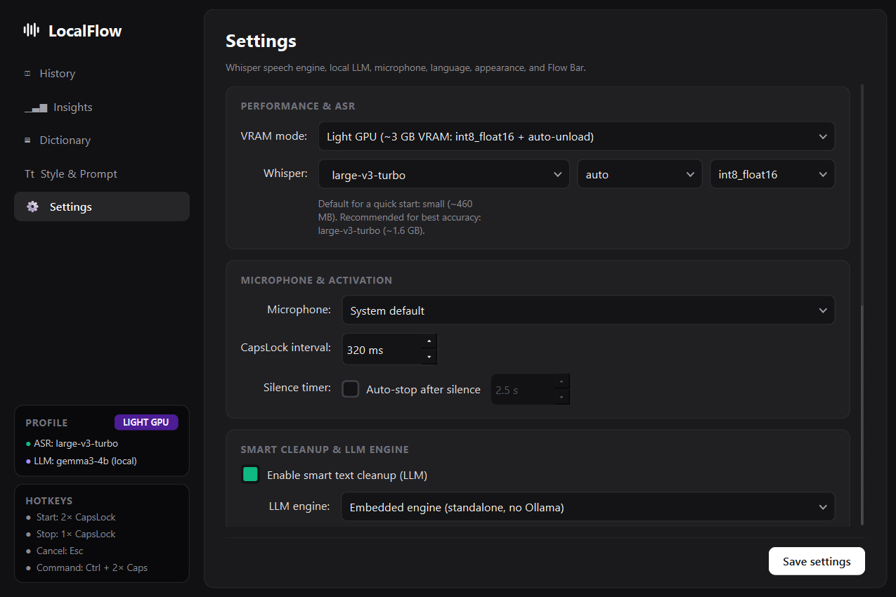
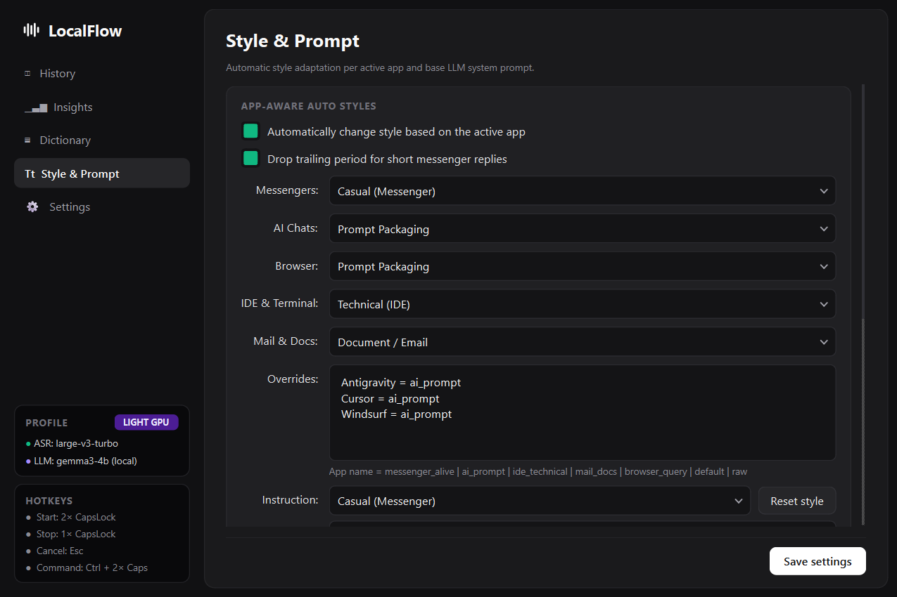

# LocalFlow

<p align="center">
  <strong>Local, privacy-first, open-source Wispr Flow alternative for Windows.</strong><br>
  Offline voice dictation & smart LLM cleanup powered by <code>faster-whisper</code> and embedded <code>llama.cpp</code> (Vulkan/CPU) or Ollama.
</p>

<p align="center">
  
  
  
  
  
  
  
</p>

<p align="center">
  
</p>

---

## Highlights

- **100% Offline & Private**: Audio and transcripts never leave your computer. No cloud accounts, API keys, or subscriptions required.
- **Global Hotkey Activation**: Double-tap `CapsLock` to start dictating from anywhere in Windows. Tap `CapsLock` again to stop, polish, and paste directly into your active window.
- **Selection Command Mode**: Highlight any text and press `Ctrl + 2× CapsLock` to transform it via voice command (*"translate to English"*, *"summarize"*, *"format as bullet list"*).
- **Floating Flow Bar**: Ultra-thin desktop pill with live audio waveform, copy-to-clipboard button, and subtle audio cues.
- **App-Aware Smart Styles**: Automatically adapts text style based on the active application (AI chats, IDEs, messengers, documents, or raw text).
- **Embedded LLM Engine**: Ships with an embedded `llama-server` runtime supporting Vulkan GPU acceleration and CPU fallback. Automatically downloads compact models in 1 click. External **Ollama** is also supported.
- **Bilingual Support**: Full interface and prompt support for **English** and **Russian**.
- **Dark, Light & System Themes**: Clean modern aesthetic with automatic Windows accent and theme detection.
- **Insights & Vocabulary**: Personal dictionary for technical terms/replacements, dictation history with search, and usage analytics.

<p align="center">
  
</p>

---

## Global Hotkeys

| Hotkey | Action |
|---|---|
| `2× CapsLock` | **Start recording** (double-tap within 320 ms). |
| `CapsLock` | **Finish & Paste**: transcribes audio, cleans with LLM, and pastes into the active input. |
| `Ctrl + 2× CapsLock` | **Command on Selection**: executes a voice command over selected text. |
| `Esc` | **Cancel recording** without pasting or modifying clipboard. |

---

## Smart Cleanup V2 (LLM Polishing)

Raw voice transcripts often contain stuttering, pause artifacts, and self-corrections. LocalFlow uses local LLMs (`gemma3-4b`, `gemma4:e4b`, `qwen2.5:1.5b`, etc.) to refine spoken audio into clean written text:

- **Self-Correction & Pivot Resolution**: If you change your mind mid-sentence (*"let's add a button, actually let's finish for today"*), LocalFlow keeps only the final intent.
- **Pause & Break Healing**: Glues thoughts split across speech pauses (`...` + Capital letter) into natural sentences.
- **Filler Word & Stammer Removal**: Strips hesitations and repeated words (*"не проводит, не делает"* &rarr; *"не делает"*, *"um"*, *"you know"*, *"ну то есть"*).
- **Technical Term Preservation**: Keeps English IT terms intact in Latin script (`fix`, `fallback`, `API`, `commit`, `Whisper`, `speech-to-text`) and heals phonetic mishearings.
- **Automatic Numbered Lists**: Enumerates multi-item prompts (*"first ..., second ..., third ..."*) into formatted Markdown lists.

---

## App-Aware Adaptive Styles

LocalFlow detects your active foreground window and selects the ideal formatting profile:

| Profile | Target Applications | Behavior |
|---|---|---|
| `ai_prompt` | Antigravity, Cursor, Windsurf, ChatGPT, Claude, Gemini | Crisp prompts, imperative voice, technical terms, auto-lists for 3+ items. |
| `messenger_alive` | Telegram, Discord, Slack, WhatsApp | Lively, conversational tone; preserves slang and emotion; removes trailing period. |
| `ide_technical` | VS Code, Visual Studio, Windows Terminal | Strict preservation of `camelCase`, `snake_case`, filenames, CLI flags, and code snippets. |
| `mail_docs` | Outlook, Word, Notion, Obsidian | Structured paragraphs and bullet points. |
| `browser_query` | Chrome, Edge, Firefox | Concise search queries without conversational fluff. |
| `raw` | Any configured app | Direct Whisper transcript without LLM post-processing. |

---

## Interface & Configuration

### Settings & LLM Engine
Configure your performance profile, choose between embedded `llama.cpp` (with Vulkan GPU / CPU) or Ollama, manage hotkeys, UI themes, and audio feedback:

<p align="center">
  
</p>

### App-Aware Style & Prompt Editor
Customize instructions per application and refine the base prompt:

<p align="center">
  
</p>

### History & Usage Analytics
Review past transcripts, search dictation logs, and monitor productivity metrics:

<p align="center">
  
</p>

---

## Installation

### For End Users

1. Download **`LocalFlow-Setup-0.2.0.exe`** from [Releases](https://github.com/AzurySound/localflow/releases).
2. Run the installer (installs per-user to `%LOCALAPPDATA%\LocalFlow`, no administrator privileges required).
   > *Note*: If Windows SmartScreen displays an alert for an unsigned executable, click **More info** &rarr; **Run anyway**.
3. On first launch, LocalFlow will prompt you to download the default lightweight models:
   - **Speech-to-Text**: Whisper `small` (~460 MB) or `large-v3-turbo` (~1.6 GB).
   - **Smart Cleanup Engine**: Embedded `llama.cpp` runtime (~30 MB) + `Qwen 2.5 1.5B` (~1.0 GB) or `Gemma 3 4B` (~2.5 GB).
4. Alternatively, switch the backend to **Ollama** in Settings to reuse your existing local models (`ollama run gemma4:e4b` or `qwen2.5:7b`).

A standalone **`LocalFlow-0.2.0-portable.zip`** is also available for portable use without installation.

---

## Development

### Prerequisites

- Windows 10 / 11 (x64)
- Python 3.12
- [uv](https://github.com/astral-sh/uv) (recommended) or pip

### Run from Source

```powershell
# Clone repository
git clone https://github.com/AzurySound/localflow.git
cd localflow

# Install dependencies and sync virtual environment
uv sync --python 3.12

# Run LocalFlow
uv run localflow
```

### Running Tests

LocalFlow has comprehensive unit and integration test coverage:

```powershell
uv run pytest -q
# 211 passed, 41 subtests passed
```

### Building the Release Package

To build the thin standalone executable, portable ZIP, and Inno Setup installer:

1. Install **Inno Setup 6** (one-time setup):
   ```powershell
   winget install JRSoftware.InnoSetup
   ```
2. Run the automated release build script:
   ```powershell
   .\packaging\build_release.ps1
   ```
The output artifacts will be created in `release\`:
- `release\LocalFlow-Setup-0.2.0.exe` (~84 MB thin installer)
- `release\LocalFlow-0.2.0-portable.zip` (~123 MB portable archive)

---

## Architecture & Tech Stack

```text
                  +---------------------------+
                  |  Win32 Low-Level Hook     |  (2x CapsLock / Ctrl+2x CapsLock)
                  +-------------+-------------+
                                |
                                v
+-----------------------------------------------------------+
|                        LocalFlow                          |
|                                                           |
|  +-------------------+              +------------------+  |
|  |   PySide6 GUI     |              |  Audio Recorder  |  |
|  | (Flow Bar, Tray,  |              |  (sounddevice,   |  |
|  |  Settings, Hub)   |              |   Silero VAD)    |  |
|  +-------------------+              +--------+---------+  |
|                                              |            |
|                                              v            |
|                                     +------------------+  |
|                                     |  faster-whisper  |  |
|                                     |  (CTranslate2)   |  |
|                                     +--------+---------+  |
|                                              |            |
|                                              v            |
|  +-------------------------------------------+---------+  |
|  |                 Smart Cleanup Engine                |  |
|  |  Embedded llama-server (Vulkan/CPU)  OR  Ollama API |  |
|  |  App-Aware Style Profiles + Custom Vocabulary       |  |
|  +-------------------------------------------+---------+  |
|                                              |            |
+----------------------------------------------|------------+
                                               v
                                  +-------------------------+
                                  | Win32 Input Injector    |  (SendInput + Auto-Paste)
                                  +-------------------------+
```

- **GUI**: PySide6 (Qt for Python)
- **Audio Capture**: `sounddevice` + `numpy` with Silero VAD
- **Speech-to-Text**: `faster-whisper` (CTranslate2) with optional CUDA acceleration
- **LLM Cleanup**: Embedded `llama.cpp` (`llama-server.exe`) or external `Ollama` HTTP API
- **Windows Integration**: Win32 low-level keyboard hooks (`SetWindowsHookExW`), clipboard preservation & keyboard emulation (`SendInput`)
- **Storage**: SQLite (`%APPDATA%\LocalFlow\history.db`) + atomic JSON configuration

---

## Configuration & Storage

User data and models are stored locally:
- **Configuration & History**: `%APPDATA%\LocalFlow\` (`config.json`, `history.db`)
- **Downloaded Models**: `%APPDATA%\LocalFlow\models\` (`whisper\`, `llm\`, `llama_runtime\`)

---

## License

This project is licensed under the [MIT License](LICENSE).
